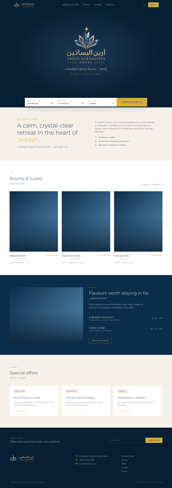

# Areen Stay

Proof-of-concept homepage for **areenstay.com**, Areen Albasateen Hotel (أرين البساتين), Jeddah.
"More than a stay" / "إقامة .. بتجربة تتجاوز التوقعات".

## Stack

Next.js 15 (App Router) · React 19 · Tailwind CSS v4 · lucide-react. Fonts: Montserrat (EN) and Tajawal (AR) via `next/font`.
`lib/utils.ts` has the `cn()` helper, so shadcn/ui can be added with `npx shadcn@latest init` later.

```bash
npm install
npm run dev   # http://localhost:3000
```

## Structure

| Section | File |
| --- | --- |
| Top bar with Book button | `components/header.tsx` |
| Hero (logo + tagline) | `components/hero.tsx` |
| Booking bar | `components/booking-bar.tsx` |
| Welcome / location | `components/intro.tsx` |
| Rooms & suites | `components/rooms.tsx` |
| Dining | `components/dining.tsx` |
| Offers | `components/offers.tsx` |
| Footer + newsletter | `components/footer.tsx` |

Brand tokens (navy, crystal, sky, gold, beige, sand, ink) live in the `@theme` block of `app/globals.css`, so they work as Tailwind classes like `bg-navy` or `text-gold`.

## Preview



## Placeholders

- `components/areen-logo.tsx` is the logo as code-drawn SVG (every part has a `data-part`, every letter is its own path). Preview it at `/logo`. Static copies: `public/brand/areen-logo.svg`, `areen-mark.svg`. Generator scripts in `scripts/logo/`.
- The header still uses PNGs cut from the brand sheet image (`public/brand/logo-*.png`).
- Photos are Unsplash stock loaded by URL, with a navy-to-crystal gradient fallback. Replace with the hotel's own photography.
- Room names, prices, offers, phone and email are sample content.
- Motion is CSS only: a fade-up on the hero, hover zoom on room cards, and lift on offer cards. Respects `prefers-reduced-motion`.
